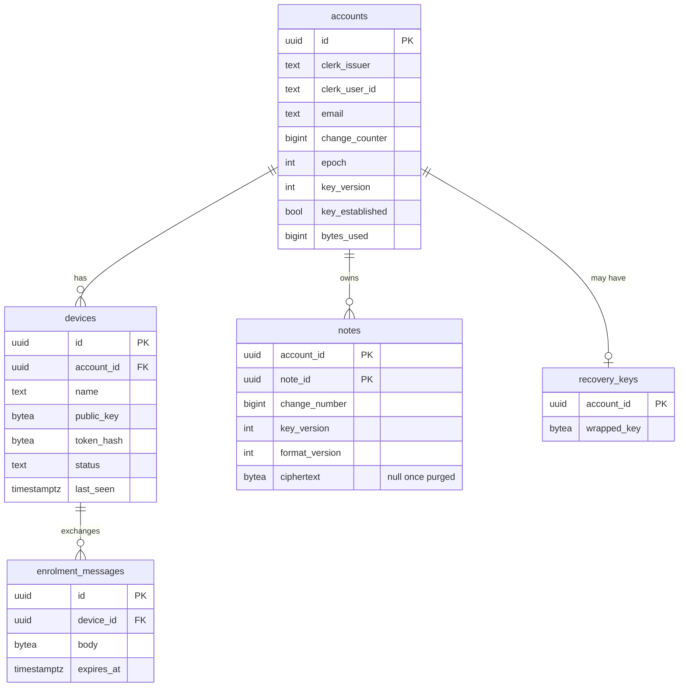

# refactor: Rebuild Dirt core and server per the 2026-11-10 redesign

## Overview

This plan implements the approved design in
`docs/plans/2026-11-10-system-redesign-design.md`. It follows the nine build
steps in section 12 of that document.

Steps 1 and 2 are planned in full here: four trials that test the design's
unverified assumptions, then a clean-up of dead code, stale docs and stale
issues. Steps 3 to 9 are outlined with deliverables, exit criteria and the
design questions each must settle first. Each of those steps gets its own
detailed plan when it is reached, because a trial result can still change a
decision.

The design's decisions are not reopened here. Research for this plan did find
facts that call for amendments, and a gap check found flows the design does
not specify. The amendments are listed in the next section. The remaining open
flows are listed per step under "Settle first".

## Amendments to the design (approved 2026-11-10)

The 21 amendments in the first three tables were approved on 2026-11-10. The
last table was approved on 2026-11-11. All are applied to the design
document.

Sources: current documentation for yrs, rusqlite, Clerk, sqlx, Neon and
Vercel, and a gap check of the design's user flows. "Affects" names the step
the item bears on.

### Corrections to facts in the design

| # | Finding | Effect on the design | Affects |
|---|---|---|---|
| A1 | Vercel's Hobby plan forbids commercial use. The fair-use guidelines say Hobby teams "are restricted to non-commercial personal use only". Donations are exempt. | Section 7.5 listed this as "to confirm". It is confirmed: charging for Dirt, or showing ads, requires the Pro plan. | Step 8 |
| A2 | Neon's free plan includes 100 compute-unit hours per project per month, which is 400 hours at the smallest size. A month has about 730 hours. The database sleeps only after five idle minutes, and clients poll every 30 seconds. | Section 7.4 covered storage only. Any client left open keeps the database awake, so the free plan cannot carry continuous use. Trial 4 measures this. Expect a paid Neon plan once there are real users. | Step 4 |
| A3 | Vercel caps request and response bodies at 4.5 MB. | The current 8 MiB push limit cannot be reached. Push batches and pull pages must be capped by bytes, at about 3 MB, not by note count. | Step 4 |
| A4 | Clerk's free plan covers 50,000 monthly retained users per app, confirmed on its pricing page. Passkeys and multi-factor login need the Pro plan in production. Email code and up to three social logins are free. | Section 13 can drop the "to confirm" on the allowance. Section 5.1 should not promise passkeys on the free plan. | Step 7 |
| A5 | A Clerk production instance needs a domain you own, with DNS records. Development instances are capped at 100 users. | A domain becomes a prerequisite for step 7. | Step 7 |
| A6 | Neon has no Tokyo region, and a project's region cannot be changed later. | The region pair must be chosen before the trial project is created. Chosen on 2026-11-10: AWS US West 2 (`aws-us-west-2`), paired with Vercel's `pdx1`. | Step 1 |
| A7 | The local toolchain is rustc 1.85.0. yrs 0.28 needs 1.95, sqlx 0.9 needs 1.94, and rusqlite 0.41 needs 1.89. | The toolchain must be updated and pinned before any trial. | Step 1 |

### Additions the design needs

| # | Addition | Why | Affects |
|---|---|---|---|
| B1 | Edits are applied to the CRDT as minimal insert and delete operations, computed by diffing the old and new text. | The editors hand over the whole text. Replacing the whole text would make two concurrent edits produce both full texts joined together. | Step 3 |
| B2 | The deletion rule uses one marker per device, and every edit also writes the last-edited time. | In yrs, a delete-only edit does not advance the state the marker compares against, so it would go unseen. With one shared marker, two devices deleting the same note can bring it back. | Step 3 |
| B3 | Each install has one CRDT client ID, stored in the local database. If the server shows more of this device's own edits than the device holds, it takes a new ID. | Two writers sharing an ID can corrupt a document. Storing the ID with the data means it is lost together with it. The check covers a restored backup. | Step 3 |
| B4 | "Changed locally" is a revision counter, not a flag. A successful push clears it only if the counter is unchanged. | An edit that lands while a push is in flight would otherwise be marked as synced and never uploaded. | Step 3 |
| B5 | The server issues a single-use nonce for each device registration, and the Clerk sign-in must request the `openid` scope. | Clerk's ID token stays valid for a day, so without a nonce it could be replayed. Without `openid` no ID token is issued at all. | Step 4 |
| B6 | A pending device may only read the recovery-wrapped key, not create or delete it. | Section 7.2 lets a pending device call all recovery endpoints. A stolen email inbox could then destroy the recovery copy. | Step 4 |
| B7 | Each account has an epoch number, returned on every call. When it changes, clients reset their cursors and merge everything again. | Clients refuse change numbers lower than they have seen. A database restore or account reset legitimately lowers them, which would leave clients stuck. | Step 4 |
| B8 | Signing out of the only approved device is blocked, with a warning, unless a recovery phrase exists. | Sign-out deletes the local keys. On the only device, that destroys the last copy of the account key. | Step 5 |

### Changes to the build order

| # | Change | Why |
|---|---|---|
| C1 | Step 3 begins by removing `dirt-api`'s dependency on `dirt-core`, and `dirt-cli`'s direct `libsql` dependency. | `rusqlite` and `libsql` each compile their own SQLite. Both in one binary fail to link, and can corrupt a file they both open. `dirt-api` uses only `Note`, `NoteId` and `SOLO_USER_ID` from core. |
| C2 | Account reset and account deletion move from step 8 to step 6. | A user with only a pending device and no recovery phrase needs reset, and reset needs the delete endpoint. |
| C3 | Step 5's multi-device tests inject the account key directly in test code. | Real enrolment of a second device arrives only in step 6. |
| C4 | Step 2 deletes only code with no live dependents. The CLI profiles and the old sync and login code are deleted by the step that replaces them. | Removing them earlier means editing code that is about to be deleted. |
| C5 | Step 2 archives the stale docs instead of rewriting them. Each is written fresh by the step that defines its subject. | The API and deploy docs would be rewritten twice otherwise. |
| C6 | A policy is needed for `dirt-mobile` between steps 3 and 7. | It will not compile against the new core until it is reconnected, yet CI checks its build. |

### Decision changed after the trials (approved 2026-11-11)

| # | Change | Why |
|---|---|---|
| D1 | Decision 4: the 30-second polling timer is removed. Clients sync on app start, on return to the app, after each local change and on a manual sync button, and retry only while changes are unsent. The device-approval screen is the one place that polls. Server push over a socket was considered again and rejected. | Trial 4 showed that a polling client keeps the Neon database awake for as long as it is open. The timer's only benefit was that an app left open updated by itself, and one person rarely uses two devices at the same moment. |

## Prerequisites

Completed on 2026-11-10, except Docker, which only needs to be running.

- [x] Rust updated to 1.99.1, with the `aarch64-linux-android` and
      `x86_64-linux-android` targets.
- [x] Dioxus CLI `dx` 0.7.9 installed.
- [x] Android tooling installed through scoop: SDK platform 36, build-tools,
      emulator, an x86_64 system image, NDK 26.3.11579264, and an emulator
      device named `dirt-trial`. Hardware acceleration works. `ANDROID_HOME`,
      `NDK_HOME` and `ANDROID_NDK_HOME` are set.
- [x] Have Docker Desktop running. Docker 29.9.2 is already installed.
- [x] Clerk application `Dirt` created as a development instance, with email
      code and Google sign-in on and passwords off.
- [x] Neon project `dirt-trial` created in AWS US West 2, on Postgres 18.
- [x] Empty Vercel project `dirt-trial` created, separate from the live
      `dirt-api` project.

Notes from the setup:

- **Secrets:** the Clerk keys and Neon connection strings are in
  `.env.trials.local` at the repo root, which is gitignored.
- **Vercel-managed accounts:** the existing Clerk and Neon organisations are
  managed by Vercel, so both resources were created through Vercel
  Marketplace on free plans. That is fine for trials. Step 8 must decide
  whether production uses standalone Clerk and Neon accounts, which the
  design's portability rule favours.
- **Postgres 18, not 17:** the Vercel flow offers no version choice. Local and
  CI Postgres must use version 18 to match.
- **Emulator on `PATH`:** the SDK's `emulator` folder was added to the user
  `PATH`.
- **JDK for Android builds:** the global `JAVA_HOME` stays on JDK 25. The
  `DIRT_ANDROID_JAVA_HOME` variable names JDK 21, and the Android `make`
  targets pass it to `dx` as `JAVA_HOME` for that command only. This works
  because `dx` reads `JAVA_HOME` first and Gradle inherits `dx`'s environment.
  The trial apps must run `dx` the same way. Whether JDK 25 would also work is
  untested; the generated project uses Gradle 9.1.0 and Android Gradle Plugin
  8.7.0.

## Step 1: Trials

### Layout and rules

- Trial code lives in `trials/<name>/`. Each trial crate has its own empty
  `[workspace]` table in its `Cargo.toml`, so it stays outside the main
  workspace and cannot affect its dependency graph.
- Work happens on a `trials/step-1` branch. Only the write-ups are merged to
  `main`; the trial code stays on the branch.
- Each trial ends with a write-up at `docs/trials/2026-11-<day>-<name>.md`
  holding the question, the method, the numbers, the verdict and the effect on
  the design.
- The four trials are independent and can run in parallel. The Android half of
  trial 3 needs the Android tooling that trial 2 sets up.
- The thresholds below are proposals. Adjust them before running, not after.

### Step 0: Toolchain

Done in pull request #247, which is open:

- [x] `rust-toolchain.toml` pins 1.99.1.
- [x] Every CI job runs `rustup toolchain install`, which installs what the
      file names, instead of `dtolnay/rust-toolchain@stable`.
- [x] Clippy passes across the whole workspace on 1.99.1. Three small fixes
      were needed, and `assert_is_empty` is allowed in the workspace lint
      table.

Found on the way: CI ran `cargo check` and `cargo clippy` without
`--workspace`. The root manifest is also a package, so only the server and
core libraries were linted. #247 adds the flag.

### Trial 1: yrs document size and the deletion rule

**Question:** does a note's CRDT document stay small enough to re-upload in
full on every edit, and can the deletion rule be implemented correctly?

**Result (2026-11-10): pass.** 15.3 KB after 1,000 diffed edits in the v2
encoding, about 15 bytes per edit, and all 31 tests pass. Code and write-up
are on the `trials/step-1` branch. Every task below was done; the deletion
marker holds edit counts kept in the document instead of the yrs state vector.

**Baseline from research** (yrs 0.25.0, a 52-byte note, small client IDs, one
transaction per edit): 12,618 bytes after 1,000 edits in the v2 encoding and
21,954 in v1. That is about 12.5 bytes per edit in v2. Size grows with the
number of edits and never shrinks.

**Tasks** (`trials/yrs-size/`)

- [ ] `src/doc.rs`: a note document with a text value, an `edited_at` map
      entry and per-device deletion markers. Fetch root types before opening a
      transaction; fetching inside one hangs.
- [ ] `src/diff.rs`: turn "old text, new text" into minimal insert and delete
      operations. Offsets in yrs are UTF-8 bytes by default; test with
      non-ASCII text.
- [ ] `src/main.rs`: measure v1 and v2 encoded size on yrs 0.28.x with a real
      53-bit client ID, for these scenarios:
  - typing a 200-character note one character at a time;
  - 1,000 edits that each change one word, applied through the diff;
  - 1,000 whole-text replacements without the diff, as the contrast case;
  - 1,000 CLI-style appends, each loading the document from bytes, editing and
    saving, with one persisted client ID;
  - the same with a fresh client ID each time.
- [ ] `tests/merge.rs`: two copies change different words offline and merge.
      The result must contain both changes once. The whole-text contrast case
      must show the duplication.
- [ ] `tests/convergence.rs`: three copies apply random edits and merge in
      every order. All must end with identical text.
- [ ] `tests/deletion.rs`:
  - delete on A, edit on B: the note is alive with B's edit;
  - delete on A, delete-only edit on B: the note is alive;
  - delete on both: the note is deleted;
  - delete, then restore: the note is alive.
- [ ] `tests/client_id.rs`: a copy that has lost state detects that the
      incoming document holds more of its own edits than it does.

**Pass**

- At most 32 KB in the smaller encoding after 1,000 diffed edits.
- Growth of at most 30 bytes per edit.
- Every merge, convergence, deletion and client-ID test passes.

**Fail:** run the same harness on Loro and Automerge. If none passes, revisit
the sync shape for long notes (design section 13).

**Record:** which encoding to use, and what the size implies for the per-note
byte cap under the 3 MB batch limit.

### Trial 2: rusqlite on Android, and two processes on one file

**Question:** does `rusqlite` with its bundled SQLite build, link and run on
Android, and can the desktop app and CLI safely share one database file?

**Result (2026-11-11): pass, with one gap.** The app and a plain cargo
binary build, link and run on the x86_64 emulator, and as arm64 through the
emulator's ARM translation. No physical arm64 device was tested. Plain cargo
links for Android, so CI does not need `dx`. Two processes lose no write and
see no busy error, given `BEGIN IMMEDIATE` and an open routine that retries
the switch to write-ahead-log mode. The trial used rusqlite 0.42, the
current version. Every task below was done. Write-up:
`docs/trials/2026-11-11-trial-2-rusqlite-android-and-two-processes.md` on
the `trials/step-1` branch.

**Known risks from research**

- CI today runs only `cargo check` for `x86_64-linux-android`. It never links,
  so link failures cannot show up.
- An open rusqlite issue reports a link failure on `x86_64-linux-android` with
  plain cargo. `dx` links the missing runtime library automatically.
- Full-text search (FTS5) is compiled into the bundled build by default.

**Tasks** (`trials/rusqlite-android/`, a minimal Dioxus mobile app)

- [ ] `Cargo.toml`: `rusqlite` 0.41 with `bundled`; no `libsql` anywhere in
      the graph.
- [ ] `src/main.rs`: on start, open a database in the app's data folder, set
      write-ahead-log mode, create an FTS5 table, insert and search, sort
      10,000 rows, and show the results and `PRAGMA compile_options` on
      screen.
- [ ] Build and run with `dx` on an x86_64 emulator and on an arm64 device or
      emulator.
- [ ] Run the existing CI commands by hand for `x86_64-linux-android`, with
      `cargo build` in place of `cargo check`, to see whether plain cargo
      links.
- [ ] `trials/sqlite-two-process/`: two Windows processes on one file. Each
      performs 1,000 write transactions opened with `BEGIN IMMEDIATE`, with a
      busy timeout, while the other reads.

**Pass**

- The app builds, links and runs on both Android architectures with `dx`.
- The search returns the inserted row, and the 10,000-row sort completes.
- `compile_options` lists `ENABLE_FTS5` and `TEMP_STORE=3`.
- The two-process run finishes with no busy error reaching the caller and no
  lost write.

**Fail:** keep `libsql` for the local file (design section 13). The rest of
the design is unaffected.

**Record:** whether plain cargo links, so step 3 knows whether CI must switch
to `dx`.

### Trial 3: Clerk sign-in from native clients

**Question:** can the desktop app, the CLI and the Android app sign in through
Clerk in the system browser, and can our server verify the result with
standard libraries?

**Result (2026-11-11): pass, with one gap.** Sign-in completed from a
terminal program on three ports and from an Android app, with an email code
and with Google, and once with the Android app killed while the browser was
open. The verifier accepted every real ID token and rejects the bad cases in
its 13 tests. The user ID matched between desktop and Android. Android was
tested on the emulator with Chrome only. Every task below was done; the
Android flow is its own app, `trials/clerk-signin-android/`, not an addition
to the trial 2 app. Write-up:
`docs/trials/2026-11-11-trial-3-clerk-sign-in.md`.

**Confirmed by research**

- Clerk supports public clients with PKCE, and accepts
  `http://127.0.0.1/callback` with any port chosen at runtime. `localhost`
  does not get that treatment.
- Clerk's Backend API accepts custom URL schemes as redirect targets. Whether
  the dashboard form accepts them is not confirmed.
- Endpoints come from `{issuer}/.well-known/openid-configuration`.

**Tasks** (`trials/clerk-signin/`)

- [ ] In the Clerk development instance, create an OAuth application: public,
      PKCE required, scopes `openid profile email`, consent screen left on,
      redirect targets `http://127.0.0.1/callback` and
      `dev.dirt.app://callback`. Use the Backend API if the dashboard refuses
      the custom scheme.
- [ ] `src/bin/desktop.rs`: read the discovery document, bind `127.0.0.1:0`,
      generate the PKCE verifier, state and nonce, open the browser, answer
      the callback, exchange the code with no client secret, and print the
      decoded tokens. Candidate crates: `openidconnect` 4.1, or `oauth2` 5
      with `jsonwebtoken` 11, and `webbrowser` 1.2.
- [ ] `src/verify.rs`: the server-side check that will move into `dirt-api`.
      It verifies an ID token against the published keys: algorithm RS256,
      issuer, audience equal to our client ID, expiry and nonce.
- [ ] `tests/verify.rs`: tokens signed by a local key. A valid token is
      accepted. Tampered, expired, wrong-audience and wrong-nonce tokens are
      rejected. This also proves the design's plan to replace Clerk with a
      local key in tests.
- [ ] Android: add the sign-in to the trial 2 app. Open the browser with
      `webbrowser`, return through an intent filter for the custom scheme into
      `MainActivity.onNewIntent`, and persist the verifier before leaving the
      app.
- [ ] Sign in with an email code and with Google on each client.

**Pass**

- Desktop and CLI complete sign-in twice, on two different random ports.
- Android completes sign-in, including when the app is killed while the
  browser is open.
- The verifier accepts the real ID token and rejects the four bad cases.
- The user ID is identical across two sign-ins and across desktop and Android.

**Fail**

- If only the custom scheme fails, use an https app link on a domain you own.
- If the flow as a whole fails, keep the existing email-code login (design
  section 13).

**Record:** the claims in the ID token and access token, whether a refresh
token is issued, what the consent screen looks like, and what the user sees
when a redirect target is wrong.

### Trial 4: Postgres on Neon from the Vercel Rust runtime

**Question:** does an axum function on Vercel reach Neon through `sqlx`, run
the real push transaction correctly under concurrency, and stay within
acceptable latency and cost?

**Result (2026-11-11): pass.** One of 50 same-base pushes accepted; 500
pushes numbered 1 to 500; no prepared-statement error across a redeploy;
warm requests at 59 ms at the 95th percentile; first request after idle in
0.99 s. `sqlx` 0.9 was kept: the builder's Rust 1.92.0 is too old for it,
and a `rust-toolchain.toml` in the project fixed that. Recorded: 182.5
CU-hours a month for one always-open client against the free 100; function
size 2.61 MB; build 2 min 52 s cold and 44 s cached; request body limit
between 4,493,163 and 4,494,140 bytes. Every task below was done, except
that the polling run ended at 76.5 minutes when the machine went to sleep.
Write-up: `docs/trials/2026-11-11-trial-4-postgres-on-neon-from-vercel.md`
on the `trials/step-1` branch.

**Known from research**

- `vercel_runtime` is now maintained by Vercel (2.4.1; the repo locks 2.2.0)
  and is in public beta. Outbound TCP from the Rust runtime is not explicitly
  documented.
- Neon's pooled endpoint runs PgBouncer in transaction mode and supports
  driver-level prepared statements. `sqlx` should work with defaults, but no
  first-hand report for sqlx 0.9 was found.
- `sqlx` migrations take a session-level lock, which the pooled endpoint does
  not support. Migrations must use the direct endpoint.
- An open issue reports that a Rust function instance is suspended right after
  it responds, so background tasks stall. Nothing may depend on work done
  after the response.

**Tasks** (`trials/vercel-neon/`, deployed as its own Vercel project with that
folder as Root Directory)

- [ ] `Cargo.toml`: `axum` 0.8, `vercel_runtime` 2.4 with `axum`, and
      `sqlx` 0.9 with `runtime-tokio`, `tls-rustls-ring-webpki`, `postgres`,
      `migrate`, `uuid`. Use the function API (`sqlx::query_as`), not the
      compile-time macros, so the Vercel build needs no database.
- [ ] `migrations/0001_init.sql`: the real schema in miniature.

  ```sql
  -- trials/vercel-neon/migrations/0001_init.sql
  CREATE TABLE accounts (
    id             uuid PRIMARY KEY,
    change_counter bigint NOT NULL DEFAULT 0
  );
  CREATE TABLE notes (
    account_id    uuid   NOT NULL REFERENCES accounts(id),
    note_id       uuid   NOT NULL,
    change_number bigint NOT NULL,
    ciphertext    bytea  NOT NULL,
    PRIMARY KEY (account_id, note_id)
  );
  CREATE INDEX notes_by_change ON notes (account_id, change_number);
  ```

- [ ] `api/axum.rs`: build a lazily connecting pool before `run()` (maximum 3
      connections, minimum 0, idle timeout 10 s, acquire timeout 15 s,
      `sslmode=require`, the pooled host). Routes: `/healthz` with no
      database, `/push`, `/pull`.
- [ ] `/push` runs the real transaction:

  ```sql
  -- trials/vercel-neon: one transaction per accepted note
  UPDATE accounts SET change_counter = change_counter + 1
   WHERE id = $1 RETURNING change_counter;          -- locks the account row

  INSERT INTO notes (account_id, note_id, change_number, ciphertext)
  VALUES ($1, $2, $3, $4)
  ON CONFLICT (account_id, note_id) DO UPDATE
     SET change_number = EXCLUDED.change_number,
         ciphertext    = EXCLUDED.ciphertext
   WHERE notes.change_number = $5                   -- the base the client saw
  RETURNING change_number;                          -- no row means "stale"
  ```

- [ ] `vercel.json`: pin the function region to `pdx1`, which is co-located
      with the Neon project in US West 2.
- [ ] `tests/`: the same transaction under `#[sqlx::test]` against a local
      Postgres from `compose.yaml`, and in a GitHub Actions service container.
      Both use Postgres 18, matching the Neon project.
- [ ] A load script that sends:
  - 50 concurrent pushes to one note with the same base;
  - 500 concurrent pushes to different notes in one account;
  - 200 sequential requests spanning a redeploy;
  - a push body just over 4.5 MB.
- [ ] Measure latency over 100 requests with the function warm and the
      database awake, then once after more than six idle minutes.
- [ ] Poll every 30 seconds for two hours, then read the compute usage in
      Neon's console and project it to a month.

**Pass**

- The function builds on Vercel, and the build log shows a Rust version that
  meets the `sqlx` requirement.
- Exactly one of the 50 same-base pushes is accepted.
- The 500 pushes get strictly increasing change numbers with no duplicates.
- No prepared-statement error across the 200 requests, with defaults or with
  the documented `statement-cache-capacity=0` setting.
- Warm requests complete within 500 ms at the 95th percentile.
- The first request after idle completes within 5 s.

**Fail**

- If the Vercel builder's Rust is too old, try `sqlx` 0.8.6 before anything
  else.
- If the runtime cannot reach Postgres or cannot meet the latency bounds,
  reconsider the host, keeping Postgres (design section 13).

**Record:** the projected monthly compute hours against the free 100, the
binary size, the build time, and the exact body limit observed.

### Step 1 exit

- [x] Four write-ups exist under `docs/trials/`.
- [x] Design section 13's table is updated with each verdict.
- [x] The approved amendments are applied to the design document.
- [ ] You review the results and confirm, or change, the affected decisions.

## Step 2: Clean-up

Rule (amendment C4): delete only what nothing live depends on.

**Result (2026-11-11): done.** Every item below is complete. Four things
differ from the list as written:

- **The Media tab also held the Export buttons,** which are a live feature.
  The tab is replaced by a "Data" tab that keeps Export and nothing else.
- **No stored OpenAI key was found** in the Windows credential store, so there
  was nothing to remove.
- **More dependencies went than the list named.** With the transcription code
  gone, the desktop crate uses none of `reqwest`, `keyring`, `image`,
  `mime_guess`, `base64` or `urlencoding` directly, so all six were removed.
  `cargo machete` is not installed; each was checked by search and by the
  build.
- **Six tests went with the deleted code,** leaving 309 passing and 8 ignored.

### Dead feature code

- [x] Delete `crates/dirt-desktop/src/services/transcription.rs` and its entry
      in `services/mod.rs`. Note the keychain service name it uses first, then
      remove the stored OpenAI key from your own keychain.
- [x] Delete `crates/dirt-desktop/src/components/settings/media_settings.rs`
      and the Media tab in `components/settings/mod.rs`.
- [x] Remove `transcription_service` from `crates/dirt-desktop/src/state.rs`
      and `app.rs`.
- [x] Remove `voice_memo_transcription_enabled` from
      `crates/dirt-core/src/models/settings.rs` and
      `db/settings_repository.rs`, with its three tests. Settings are stored
      as key and value rows, so the old row is simply never read again.
- [x] `crates/dirt-desktop/Cargo.toml`: drop the `multipart` feature of
      `reqwest`. Run `cargo machete` and remove what it confirms unused. A
      search found no use of `mime_guess`, `base64`, `urlencoding` or `image`
      in the desktop crate.

### Continuous integration

- [x] Delete `.github/workflows/managed-mode-e2e.yml` and
      `.github/scripts/managed-mode-e2e.sh`. The script runs name filters for
      tests in modules that no longer exist. Cargo exits successfully when a
      filter matches nothing, so the workflow reported success nightly while
      checking nothing, until GitHub disabled it for inactivity in July.
- [x] `.github/scripts/security-guard.sh`: remove the names that no longer
      exist (`DIRT_SERVER_TOKEN`, `TURSO_ADMIN_AUTH_TOKEN`,
      `TURSO_GROUP_TOKEN`, the AWS keys). Keep the Turso names until step 4
      replaces them.

### Documentation

Done on 2026-11-10, except the `Makefile` item:

- [x] Moved to `docs/archive/`, each with a banner saying how it is out of
      date: `BACKEND_API.md`, `DEPLOY.md`, `SECURITY_BASELINE.md`,
      `SECURITY_OPERATIONS.md`, `feature-parity.md`, `RELEASE_CHECKLIST.md`
      (it requires a workflow being deleted and a `MANUAL_QA_MANAGED_MODE.md`
      that does not exist), and
      `plans/2026-02-04-feat-phase-0-and-1-desktop-mvp-plan.md`. An index is
      at `docs/archive/README.md`.
- [x] `docs/DESIGN.md`: the old document is archived whole as
      `docs/archive/DESIGN-2026-02.md`. The new one keeps the vision,
      principles, non-goals and the product decisions that still hold, and
      points to the redesign for architecture.
- [x] `CLAUDE.md`: tech stack and project structure corrected (it said Dioxus
      0.6, called the CLI a placeholder, and named PowerSync as future sync).
      It now points to the redesign document and this plan.
- [x] `README.md`: rewritten for the code as it is today, with a status
      section, the correct server variables, and the known limitations.
- [x] `api/axum.rs`: the header said Vercel's Root Directory is
      `crates/dirt-api/`; it is the workspace root. Comment fixed.
- [x] `Makefile`: remove `run-mobile-ios` and `run-mobile-web`, which are out
      of scope.

### Issues

All 14 open issues, with a comment on each linking the redesign document.

| Action | Issues | Reason |
|---|---|---|
| Close as obsolete | #209, #213, #214, #219, #220, #221 | They describe Turso client tokens, token exchange, embedded replicas or the attachment panel, all deleted in April |
| Close as obsolete | #212 | No 120 ms sleep remains in the code |
| Close as superseded | #215 | The `sync_conflicts` table was dropped; the CRDT replaces conflict detection |
| Keep, link to step 3 | #234, #210, #218 | Still true today (`Arc<Mutex<Database>>` at `crates/dirt-core/src/services/database.rs:24`); fixed by the per-account store and the connection model |
| Keep, link to step 5 | #211, #216 | Fixed by the shared sync worker and the four error classes |
| Keep, link to step 7 | #217 | Replaced by the sync status view |

- [x] Verify each "obsolete" claim against the code before closing.
- [x] Created the "Redesign" milestone with one tracking issue per build
      step: #237 (step 1) through #245 (step 9). The six issues kept open
      above are in the milestone too.

### Step 2 exit

- [x] `cargo fmt --all`, `cargo clippy --all-targets --all-features -- -D warnings`
      and `cargo test --all` pass.
- [x] The desktop app starts, and Settings opens with no Media tab.
- [x] A case-insensitive search for `transcri` under `crates/` returns nothing.
- [x] No document in the root of `docs/` describes a shared bearer token.
- [x] Every open issue is linked to a build step.

## Steps 3 to 9: outline

Each step gets its own plan. "Settle first" lists gap-check findings with a
proposed default; each needs a decision before that step's plan is written.

### Step 3: New local core

- **First move:** amendment C1. Cut `dirt-api` loose from `dirt-core`
  (`routes.rs:13`, `turso.rs:26`, and the `SOLO_USER_ID` uses) and drop
  `libsql` from `dirt-cli`, so the server keeps building on `libsql` while the
  core moves to `rusqlite`.
- **Deliverables:**
  - `dirt-proto`.
  - The notes module: yrs document, diffed edits, per-device deletion markers,
    derived text and tags.
  - The store: `rusqlite`, one writer thread with separate read connections,
    write-ahead-log mode, immediate write transactions, and the revision
    counter.
  - Desktop and CLI working locally on the new core.
- **Constraint from research:** the async wrappers `tokio-rusqlite` and
  `deadpool-sqlite` do not yet support rusqlite 0.41. Use a hand-written
  writer thread, or `r2d2_sqlite` for readers. Check again against 0.42,
  which trial 2 used.
- **From trial 2:**
  - The open routine sets the busy timeout, then retries the switch to
    write-ahead-log mode. The busy timeout alone does not cover it.
  - Schema set-up checks the version inside a `BEGIN IMMEDIATE`
    transaction.
  - The two-process test is modelled on
    `trials/sqlite-two-process/tests/two_process.rs` and keeps its two
    controls. It runs on Windows, macOS and Linux in CI, because file
    locking differs between them.
  - The Android CI job changes from `cargo check` to `cargo build`.
  - A waiting writer can wait far longer than one write takes: up to 1.3 s
    with four processes writing without pause. Keep bulk work, such as an
    import, in short transactions.
- **Settle first:**
  - Where notes go while signed out, pending, or after sign-out, and which
    account inherits them. Default: one "local" store used whenever the
    session is not ready, merged into the account on reaching ready after a
    confirmation naming the account.
  - Whether `dirt-mobile` is kept compiling with a stub or dropped from CI
    until step 7 (amendment C6).
  - Durability setting. Default: `synchronous=FULL`, so a saved note survives
    power loss.
- **Exit:** the convergence and deletion tests pass in `dirt-core`; create,
  edit, delete, search, tags and export work in desktop and CLI; the
  two-process test passes; #234, #210 and #218 are closed.

### Step 4: Server

- **Deliverables:**
  - The Postgres schema, with migrations run against the direct endpoint.
  - The device registry and its status rules.
  - Push and pull with the version check and byte-capped batches.
  - Quotas and request counts in the database.
  - Clerk ID-token verification with a server nonce. Start from
    `trials/clerk-signin/src/verify.rs` and its tests, which sign tokens
    with a local key.
  - `compose.yaml` and a CI Postgres service.
  - Fresh `BACKEND_API.md` and `DEPLOY.md`.
  - Deletion of `routes_auth.rs`, `email.rs`, `rate_limit.rs` and `turso.rs`.
- **Settle first:**
  - The account epoch (amendment B7).
  - What "first device" means when two sign-ins race, or when all devices have
    expired. Default: an atomic "key established" flag on the account.
  - How purged notes appear. Default: a row with no ciphertext that still
    carries a change number; unseen edits to a purged note become a new note.
  - Account-wide quota behaviour. Default: an account-level "storage full"
    state in which deletes are always accepted.
  - The exact quota numbers.
- **From trial 4:**
  - Use the trial's push statement, not the one in this plan. The plan's
    inserted a missing note whatever base the client sent.
  - The server uses the pooled endpoint with `sqlx` defaults. Migrations use
    the direct endpoint.
  - The repository's `rust-toolchain.toml` (pull request #247) makes Vercel
    build with the pinned Rust. This also applies to the live project on its
    next deploy.
  - With no polling timer (amendment D1), most syncs arrive on a new database
    connection and many on a sleeping database. A new connection costs about
    75 ms and a wake-up about 1 s. Neither needs work.
- **Exit:** tests for the version check under concurrency, account isolation,
  pending-device rights and quotas pass; the server is deployed to a preview.

Proposed schema, from design section 7.3 plus amendments B6 and B7:



### Step 5: Encryption and sync for one device

- **Deliverables:**
  - The crypto module: account key, and note encryption bound to the account,
    note, key version and format version.
  - The identity module: Clerk sign-in and device registration. Start from
    `trials/clerk-signin/src/flow.rs`. The client discards Clerk's access
    and refresh tokens, checks the callback's `iss` parameter, and on
    desktop listens until the person cancels.
  - A choice of TLS set-up for Android. Trial 3 used rustls with `ring` and
    root certificates compiled in, which builds with no extra tooling but
    ignores certificates the user installed. `reqwest`'s own options need
    either OpenSSL built for Android or a platform verifier with Kotlin
    code. Default: the trial's set-up.
  - The secrets module and the server client.
  - The sync cycle and background worker in `dirt-core`. The worker is driven
    by events and has no timer (amendment D1): app start, return to the app,
    a local change, the sync button, and retry while changes are unsent.
  - The session object and its states.
  - The multi-device simulation harness (amendment C3).
  - Deletion of `dirt-core/src/sync/`, `dirt-core/src/auth/` and both
    `sync_worker.rs` files.
- **Settle first:**
  - Unreadable blobs. Default: never push over a blob the client could not
    read; hold that note only; stop all sync only for a newer protocol
    version.
  - Expired versus revoked tokens. Default: an expired device signs in again
    as the same device with no new approval; a revoked one needs approval.
  - Who syncs when desktop and CLI share a machine. Default: the CLI syncs
    after each write unless the desktop holds a lock; the desktop watches the
    database for CLI writes.
  - The sign-out guard (amendment B8).
- **Exit:** the simulation and tampering tests pass; the desktop signs in and
  syncs with one device; #211 and #216 are closed.

### Step 6: More devices

- **Deliverables:**
  - The approval exchange, with polling only while the approval screen is
    open (amendment D1).
  - The recovery phrase.
  - The device list with removal.
  - Account reset and account deletion (amendment C2).
  - Fresh security docs.
- **Pointer from research:** Matrix's short-code verification is the
  established protocol to model. The `vodozemac` crate implements its key
  agreement and code derivation; the commitment exchange is left to the
  caller.
- **Settle first:**
  - What a pending device may do, and when a pending request expires. Default:
    full local use; the server reports how many approvers exist and whether a
    phrase exists; requests expire after seven days.
  - Approval details. Default: a `dirt devices approve` command for CLI-only
    users; rejection and a code mismatch both revoke the request, with a
    warning on mismatch; a cap of three pending devices.
  - The stated limit that a removed device keeps the old key until rotation in
    step 8.
  - From trial 3: whether to keep Clerk's consent screen, which asks on every
    sign-in whether an application may "access Dirt" and names `127.0.0.1`.
    Default: keep it until it is known whether Clerk allows it off for a
    public client.
  - From trial 3: sign-in for a CLI on a machine with no browser. Default:
    Clerk's device-code grant, which is off by default and untested.
- **Exit:** the enrolment tests pass, including a server that swaps a key.

### Step 7: Clients reconnected

- **Order:** desktop, then CLI, then Android.
- **Deliverables:**
  - The session states and approval prompt in each interface.
  - The sync status view, with a manual sync button and the time of the last
    sync, in every client (amendment D1).
  - Sync on return to the app: window focus on desktop, resume on Android.
  - CLI commands for sign-in, devices and verbose sync.
  - Deletion of `config_profiles.rs` and the old `auth_cmd.rs`.
  - The Android return from the browser. Start from
    `trials/clerk-signin-android/`: a `singleTask` activity, an intent
    filter for the custom scheme, and the attempt saved before the browser
    opens. Replace the trial's file hand-off with a JNI call, and consider
    opening a custom tab in place of a full browser tab.
  - One sign-in on a physical Android device, which no trial covered.
  - A fresh feature-parity document.
- **Settle first:**
  - Android process death during sign-in. Default: persist the verifier and
    key pair before opening the browser, and make registration repeatable by
    public key.
  - The Clerk production instance and its domain (amendment A5).
- **Exit:** the manual checklist passes on all three clients; #217 is closed.

### Step 8: Hardening

- **Deliverables:**
  - A scheduled database dump stored outside Neon.
  - Key rotation.
  - A limits review.
  - The Neon and Vercel plan decisions (amendments A1 and A2).
- **Settle first:** rotation with offline devices. Default: the server keeps a
  wrapped key per device per version; pushes under an old key are refused with
  "re-encrypt"; any device can resume an interrupted rotation; rotation
  cancels the recovery phrase and prompts for a new one.

### Step 9: Attachments

- **Before planning:** a short design review. The gap check found that
  "30 days after removal has settled" is not well defined when a long-offline
  device can bring a note back. Default: base file expiry on the note's purge
  marker.
- **Deliverables:** as in design section 10.

## Acceptance criteria for this plan

- [ ] Steps 1 and 2 meet their exit lists above.
- [x] Every amendment in this document is approved, changed or rejected, and
      the design document reflects the outcome.
- [ ] A detailed plan for step 3 exists before step 3 starts.

## Risks

| Risk | Likelihood | Response |
|---|---|---|
| New lints from the toolchain jump break `-D warnings` across code due for deletion | High | Allow specific lints per crate with a comment naming the removing step |
| Neon's free compute is exhausted | Low at first; rises as more people sync through the day | The polling timer is removed (amendment D1), so the database is awake only around real use. Budget for a paid plan |
| Android tooling setup takes longer than the trials | Medium | Run trials 1 and 4 and the desktop half of trial 3 first |
| The Vercel Rust runtime is in beta, with an open issue about suspended instances | Medium | Do no work after the response; the server stays a plain axum app, so changing host is a deployment change |
| `dirt-mobile` rots between steps 3 and 7 | Medium | Decide amendment C6 before step 3 |
| The app has no sync between steps 3 and 5 | Certain | Accepted in the design; holds only while there is no data to preserve |

## Rough effort

These are guesses, assuming AI-assisted work and no surprises.

| Item | Effort |
|---|---|
| Step 0 toolchain | Half a day |
| Trial 1 | Half a day |
| Trial 2 | One day, mostly Android tooling |
| Trial 3 | One day |
| Trial 4 | One day, plus two hours of unattended polling |
| Step 2 | One day |

## References

### Internal

- Design: `docs/plans/2026-11-10-system-redesign-design.md`
- Server entry point: `api/axum.rs`; routing: `vercel.json`
- Android CI job: `.github/workflows/ci.yml:173`
- Android activity that receives intents:
  `crates/dirt-mobile/android/MainActivity.kt:40`
- Core's use by the server: `crates/dirt-api/src/routes.rs:13`,
  `crates/dirt-api/src/turso.rs:26`
- Shared database lock: `crates/dirt-core/src/services/database.rs:24`

### External

- yrs: [versions](https://crates.io/crates/yrs/versions),
  [source for 0.28.1](https://docs.rs/crate/yrs/0.28.1/source/src/),
  [Yjs internals](https://github.com/yjs/yjs/blob/main/INTERNALS.md),
  [size benchmarks](https://github.com/dmonad/crdt-benchmarks)
- rusqlite: [build notes](https://github.com/rusqlite/rusqlite#notes-on-building-rusqlite-and-libsqlite3-sys),
  [x86_64 Android link issue](https://github.com/rusqlite/rusqlite/issues/1380),
  [bundled build flags](https://docs.rs/crate/libsqlite3-sys/0.39.1/source/build.rs),
  [SQLite write-ahead log](https://www.sqlite.org/wal.html),
  [libsql symbol clash](https://github.com/tursodatabase/libsql/issues/1982)
- Dioxus: [mobile guide](https://dioxuslabs.com/learn/0.7/guides/platforms/mobile)
- Clerk: [Adding Clerk auth to your CLI](https://clerk.com/blog/adding-clerk-auth-to-your-cli),
  [reference implementation](https://github.com/clerk/cli-auth-example),
  [How Clerk implements OAuth](https://clerk.com/docs/guides/configure/auth-strategies/oauth/how-clerk-implements-oauth),
  [verifying OAuth tokens](https://clerk.com/docs/guides/configure/auth-strategies/oauth/verify-oauth-tokens),
  [environments](https://clerk.com/docs/guides/development/managing-environments),
  [pricing](https://clerk.com/pricing)
- Device verification: [Matrix short-code verification](https://spec.matrix.org/v1.19/client-server-api/#short-authentication-string-sas-verification),
  [vodozemac](https://github.com/matrix-org/vodozemac)
- Vercel: [Rust runtime](https://vercel.com/docs/functions/runtimes/rust),
  [function limits](https://vercel.com/docs/functions/limitations),
  [fair-use guidelines](https://vercel.com/docs/limits/fair-use-guidelines#commercial-usage),
  [connection pooling guide](https://vercel.com/kb/guide/connection-pooling-with-functions),
  [suspended-instance issue](https://github.com/vercel/vercel/issues/17351)
- sqlx: [changelog](https://github.com/launchbadge/sqlx/blob/main/CHANGELOG.md),
  [features](https://docs.rs/crate/sqlx/0.9.0/features),
  [test attribute](https://docs.rs/sqlx/latest/sqlx/attr.test.html)
- Neon: [connection pooling](https://neon.com/docs/connect/connection-pooling),
  [plans](https://neon.com/docs/introduction/plans),
  [regions](https://neon.com/docs/introduction/regions),
  [connection latency](https://neon.com/docs/connect/connection-latency)
- GitHub Actions: [Postgres service containers](https://docs.github.com/en/actions/tutorials/use-containerized-services/create-postgresql-service-containers)
